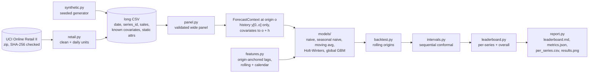
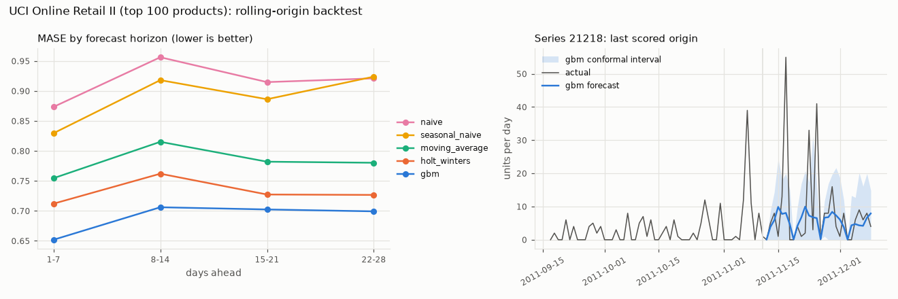

# demand-forecasting-backtest

[](https://github.com/rahulkumar96t/demand-forecasting-backtest/actions/workflows/ci.yml)

Daily retail demand forecasting with an honest rolling-origin backtest. Five models (naive,
seasonal naive, moving average, damped Holt-Winters and a global gradient-boosting model) are
refitted at every forecast origin and compared on MASE, sMAPE, MAE, RMSE and bias. Every model
gets conformal prediction intervals, and the gradient-boosting model also gets quantile-regression
intervals, so their coverage can be compared. It runs on a real open dataset (UCI Online Retail
II, CC BY 4.0) and on a seeded synthetic multi-store panel with planted effects. The point is to
show what an honest evaluation looks like: no model ever sees data after its origin, and tests
check this explicitly.

## Problem

A retailer wants 28-day daily forecasts per product (and store) for replenishment, with a range
it can trust. Two things make this easy to get wrong:

- **Leakage.** Rolling means, lags or a scaler fitted on the full series quietly use the future.
  A single train/test split then flatters the model.
- **One lucky window.** A single holdout month says little. You need many origins, a metric that
  is comparable across series of very different volume (MASE), a bias check, and intervals whose
  coverage is measured rather than assumed.

## Data

| dataset | source and licence | size used | how to get it |
|---|---|---|---|
| UCI Online Retail II | Chen, D. (2012), UCI Machine Learning Repository, [doi:10.24432/C5CG6D](https://doi.org/10.24432/C5CG6D), **CC BY 4.0** | 100 products x 739 days (2009-12-01 to 2011-12-09), 1,067,371 raw invoice lines | `make retail`: 45.6 MB zip, SHA-256 checked, about 25 s to parse |
| Synthetic panel | this repository (`synthetic.py`), seeded | 5 stores x 20 items = 100 series x 1,096 days (2022-01-01 to 2024-12-31) | `make synthetic` |

**Online Retail II** is all invoice lines of a UK online gift-ware retailer, many of whose
customers are wholesalers. `retail.py` turns it into daily units per product:

- The workbook has one sheet per year, and the sheets overlap on 1-9 Dec 2010: 22,523 lines
  appear in both. They were checked to be identical in invoice, product, quantity, timestamp and
  price, and the first sheet is cut at 2010-12-01.
- It drops cancellations (`C` invoices), non-positive quantities or prices, and non-product
  codes (postage, fees, adjustments, gift vouchers).
- It keeps the 100 products with the most selling days **in the first year only**, so choosing
  the products does not peek at the backtest period. Products that later sell little stay in.
- Days without sales become 0. A known-in-advance `holiday` flag marks England and Wales bank
  holidays.

The data is hard. Saturdays have almost no sales, the shop closes over Christmas, about 32 % of
product-days are zero, and wholesale orders make a product's biggest day typically 24 times
its mean daily volume (up to 81 times). The raw data is never committed. `data/` is gitignored.

**The synthetic panel is synthetic.** It exists for the tests and as a controlled benchmark with
known structure. The planted effects are:

- **Level:** log-normal item demand times a store size factor. A quarter of the items are slow
  movers (under 1.5 units a day), so their demand is intermittent.
- **Trend:** a per-series growth rate, on average +3 % a year.
- **Weekly and yearly seasonality:** a day-of-week profile per category, and a yearly cosine
  with a category-specific peak (summer drinks, December gifts).
- **Holidays:** stores close on 1 Jan and 25 Dec, and trade at 60 % on three other days.
- **Promotions:** 5-10 day episodes every 4-10 weeks, with an x1.3-2.2 uplift, followed by a
  7-day dip to 85 %.
- **Noise:** negative-binomial counts.

The promotion plan and the holiday calendar are covariates known in advance. Both files carry
28 "future" rows with empty sales, so `forecast` can go past the end of the data.

## Approach



**Rolling-origin backtest** (`backtest.py`). Origins are `step` days apart, and the last one
ends `horizon` days before the end of the data. At each origin every model is refitted and
forecasts `horizon` days. The defaults are horizon 28, step 28 (so the scored windows don't
overlap), 8 scored origins, and before them 4 *calibration* origins. Calibration origins are not
scored; their errors only seed the conformal intervals. A model only ever receives a
`ForecastContext`, whose `history` array physically ends at the origin.

**Models** (`models/`):

| model | what it does |
|---|---|
| `naive` | last observed value |
| `seasonal_naive` | same weekday last week |
| `moving_average` | mean of the last 28 days |
| `holt_winters` | statsmodels `ExponentialSmoothing`, additive damped trend + additive weekly seasonality, per series, last 365 days; falls back to seasonal naive if a fit fails (none did in the runs below) |
| `gbm` | one scikit-learn `HistGradientBoostingRegressor` for all series and all horizons (150 trees, learning rate 0.1, Poisson loss), refitted at every origin on training origins every 14 days over the last 364 days; two quantile models (10 % / 90 %) give its own interval |

**Global model features** (`features.py`). One row means "series *j*, standing at origin *o*,
forecasting *h* days ahead". The features are:

- the level (28-day mean);
- the last value, 7- and 91-day means, the 28-day standard deviation and the share of zero days;
- the most recent same weekday and the mean of the last four;
- the same weekday 52 weeks before the target;
- days since the last sale;
- the horizon *h* and the target date's calendar;
- known covariates on the target date and over the week before it;
- static store / item / category as categoricals.

Every target-derived value is read at or before *o* and divided by the level, so one model
learns shapes across products of very different volume. Training rows are past (origin, h) pairs
whose target date is at or before the current origin. This is direct multi-horizon forecasting,
with no recursion.

**Intervals** (`intervals.py`). Sequential split conformal works like this:

- For each model and horizon step, it pools the signed errors of earlier origins across series,
  each divided by the series' MASE scale.
- An error from origin *o_j* at step *h* is only used once it has been observed, i.e. when
  *o_j + h <= o*.
- The 10 % and 90 % empirical quantiles are taken separately, which allows asymmetric intervals
  for skewed demand.

**Metrics** (`metrics.py`, `leaderboard.py`):

- **MASE** divides by the in-sample mean absolute weekly difference, per series and per origin.
  It is the ranking metric, averaged over series.
- **sMAPE** is in percent, with 0/0 counted as 0.
- **Pooled MAE and RMSE** show the volume view.
- **Bias** is total forecast minus total actual, as a percentage of total actual.
- **Coverage** of the 80 % interval is reported as measured, not assumed.
- **MSIS** (scaled interval score, as in M4) scores width and misses together.
- **Wins** is the number of series on which a model has the best MASE.

## Results

Measured on 18 Nov 2026 on an Apple M4 Pro laptop (12 cores, 24 GB, macOS), with Python 3.12.11,
numpy 2.5.5, pandas 3.1.1, scikit-learn 1.9.1 and statsmodels 0.15.0. The commands were:

```bash
make backtest-synthetic   # uv run demand-forecast backtest --data data/synthetic.csv ... --gbm-threads 1 --jobs 1
make backtest-retail      # uv run demand-forecast backtest --data data/online_retail.csv ... --gbm-threads 1 --jobs 1
```

Both use the defaults: horizon 28 days, step 28, 8 scored origins after 4 calibration origins,
80 % intervals. That is 22,400 scored forecasts per model and dataset (100 series x 8 origins x
28 days). All numbers below are copied from `reports/*/leaderboard.md` and `metrics.json`,
which those commands wrote.

**Run time.**

| run | CPU time (user + sys) | awake wall time |
|---|---:|---:|
| synthetic | 202.5 s | 206.6 s |
| retail | 193.6 s | 197.6 s |

- Awake wall time comes from the process's monotonic clock, which on macOS stops during sleep.
- Most of the time goes to Holt-Winters (1,200 per-series fits, about 140 s) and the GBM (36
  fits, 49-62 s).
- The two runs ran concurrently. The laptop was on battery, in Low Power Mode and asleep most
  of the time, so the elapsed clock time was about 58 minutes. That figure measures the
  laptop's sleep, not the code.

### Synthetic panel (5 stores x 20 items, scored origins 2024-05-21 to 2024-12-03)

| model | MASE (mean) | MASE (median) | sMAPE % | MAE | RMSE | bias % | 80 % coverage | MSIS | wins | CPU s / origin |
|---|---:|---:|---:|---:|---:|---:|---:|---:|---:|---:|
| gbm | **0.744** | 0.739 | 75.2 | 5.75 | 10.63 | +1.0 | 0.774 | 3.38 | 86 | 4.86 |
| holt_winters | 0.804 | 0.801 | 78.3 | 6.35 | 11.79 | +0.9 | 0.775 | 3.67 | 5 | 9.37 |
| moving_average | 0.821 | 0.814 | 78.8 | 6.55 | 12.21 | -0.2 | 0.780 | 3.61 | 4 | 0.00 |
| naive | 1.032 | 0.997 | 84.1 | 8.48 | 15.87 | -7.6 | 0.771 | 4.76 | 4 | 0.00 |
| seasonal_naive | 1.039 | 1.038 | 82.4 | 8.46 | 15.79 | +0.3 | 0.783 | 4.68 | 1 | 0.00 |

| interval | coverage (target 0.80) | mean width / scale | MSIS |
|---|---:|---:|---:|
| gbm, conformal | 0.774 | 2.06 | 3.38 |
| gbm, quantile models | 0.887 | 2.53 | 3.39 |
| holt_winters, conformal | 0.775 | 2.23 | 3.67 |
| seasonal_naive, conformal | 0.783 | 2.62 | 4.68 |

What the synthetic run shows:

- **The GBM ranks first.** It has the best MASE on 86 of 100 series. Head to head, it beats
  seasonal naive on 99 series and Holt-Winters on 91. It knows the promotion plan and the
  holiday calendar; the other models do not.
- **Seasonal naive is no better than naive here.** The planted noise is negative-binomial, so
  one same-weekday value is a noisy forecast. A 28-day mean is much better.
- **Bias is within ±1 %** for every model except naive.
- **Conformal intervals slightly under-cover** (0.77-0.78 against 0.80).
- **The GBM's quantile models over-cover** (0.89) with wider intervals, at the same interval
  score.

### UCI Online Retail II (100 products, scored origins 2011-04-29 to 2011-11-11)

| model | MASE (mean) | MASE (median) | sMAPE % | MAE | RMSE | bias % | 80 % coverage | MSIS | wins | CPU s / origin |
|---|---:|---:|---:|---:|---:|---:|---:|---:|---:|---:|
| gbm | **0.690** | 0.673 | 120.0 | 24.41 | 77.57 | -10.3 | 0.803 | 3.93 | 53 | 3.86 |
| holt_winters | 0.732 | 0.706 | 99.0 | 26.11 | 77.77 | -1.7 | 0.805 | 4.05 | 26 | 9.68 |
| moving_average | 0.783 | 0.772 | 113.5 | 28.19 | 79.60 | -5.1 | 0.786 | 4.13 | 4 | 0.00 |
| seasonal_naive | 0.889 | 0.829 | 95.4 | 32.98 | 117.79 | -1.0 | 0.820 | 5.51 | 4 | 0.00 |
| naive | 0.916 | 0.839 | 119.7 | 36.77 | 173.12 | +1.0 | 0.802 | 5.26 | 18 | 0.00 |

| interval | coverage (target 0.80) | mean width / scale | MSIS |
|---|---:|---:|---:|
| gbm, quantile models | 0.889 | 1.52 | 3.68 |
| gbm, conformal | 0.803 | 1.54 | 3.93 |
| holt_winters, conformal | 0.805 | 1.55 | 4.05 |
| seasonal_naive, conformal | 0.820 | 1.66 | 5.51 |

MASE by horizon week (lower is better):

| days ahead | gbm | holt_winters | moving_average | seasonal_naive | naive |
|---|---:|---:|---:|---:|---:|
| 1-7 | 0.652 | 0.712 | 0.755 | 0.830 | 0.874 |
| 8-14 | 0.706 | 0.762 | 0.815 | 0.918 | 0.956 |
| 15-21 | 0.702 | 0.727 | 0.782 | 0.886 | 0.915 |
| 22-28 | 0.699 | 0.727 | 0.780 | 0.924 | 0.921 |



On real data the picture is more mixed, and that is the point of reporting more than one
metric:

- **Accuracy.** The GBM has the best MASE at every horizon week. It beats seasonal naive on 88
  series and Holt-Winters on 72.
- **Volume bias.** The GBM under-forecasts total volume by 10.3 %, against 1.7 % for
  Holt-Winters. For stock planning that matters as much as MASE.
- **sMAPE.** The GBM has the worst sMAPE (120 %), because it forecasts small positive amounts on
  the many zero days. Seasonal naive copies last week's zeros and has the best sMAPE (95 %).
- **Intervals.** Conformal coverage lands on target for the GBM and Holt-Winters (0.80). The
  quantile models again over-cover (0.89) but score a better MSIS (3.68 against 3.93).
- **Per-series coverage.** Pooling hides spread across series. For the GBM's conformal
  intervals, per-series coverage ranges from 0.57 to 1.00 on this data (0.62 to 0.92 on the
  synthetic panel). Only 71 % of products (83 % of synthetic series) fall between 0.70 and 0.90.

## How to reproduce

Requires [uv](https://docs.astral.sh/uv/). Python 3.12 is pinned in `.python-version` (3.11+ works).

```bash
make install            # uv sync --locked
make synthetic          # data/synthetic.csv (seeded, about 1 s)
make retail             # downloads + checks + aggregates Online Retail II -> data/online_retail.csv
make backtest-synthetic # reports/synthetic/
make backtest-retail    # reports/online_retail/
make test               # pytest, offline
```

Each `backtest` run writes:

- `leaderboard.md` / `leaderboard.csv`: the overall leaderboard;
- `per_series.csv`: every series x model with its rank;
- `metrics.json`: configuration, environment, leaderboards, MASE by horizon and run time;
- `results.png`: MASE by horizon week, plus one typical series with its last forecast and interval.

## Usage

```bash
uv run demand-forecast generate --stores 5 --items 20 --days 1096 --seed 7 --out data/synthetic.csv
uv run demand-forecast download --series 100 --out data/online_retail.csv
uv run demand-forecast backtest --data data/synthetic.csv --horizon 28 --step 28 --origins 8 \
    --calibration-origins 4 --alpha 0.2 --models seasonal_naive,holt_winters,gbm --out reports/run
uv run demand-forecast forecast --data data/synthetic.csv --model gbm --out data/forecast.csv
```

`forecast` refits on all the data and forecasts the next `--horizon` days past the last
observation. Its conformal interval comes from the `--calibration-origins` most recent backtest
origins. `--gbm-threads` caps the OpenMP threads of the gradient-boosting fits, and `--jobs`
fits Holt-Winters series in parallel processes.

Any daily panel works if it follows the CSV contract in `panel.py`:

- one row per `date` and `series_id`, with no gaps;
- a non-negative `sales` column, empty only on trailing future rows;
- numeric columns are treated as covariates known in advance;
- text columns are treated as static series attributes.

## Design decisions and trade-offs

- **Leakage is prevented by construction, then tested.** A model gets a `ForecastContext`
  whose history ends at the origin, so it cannot read the actuals it is scored on. The feature
  builder only indexes values at or before each row's own origin. `tests/test_leakage.py`
  rewrites everything after an origin with random values and requires identical features,
  forecasts and intervals.
- **Direct multi-horizon instead of recursive.** Origin-anchored features make one global model
  cover all 28 steps without feeding forecasts back in, so errors don't compound. The cost is
  that a row cannot use actuals between the origin and the target date, which is the honest
  situation anyway.
- **Scale-free global model.** Dividing by the 28-day level (plus one unit, so slow movers don't
  divide by zero) lets one model learn from products selling 0.5 or 130 units a day. The "+1"
  assumes the target is in units. A revenue series would need a different offset.
- **Poisson loss** suits non-negative counts and never forecasts below zero. Intervals come
  from separate quantile models or from conformal calibration.
- **MASE ranks, sMAPE is only reported.** sMAPE is unstable on intermittent demand: a forecast
  of 1 against an actual of 0 scores 200 %. MASE is averaged over series so that large series
  don't dominate. Pooled MAE and RMSE are reported for the volume view.
- **Step = horizon = 28** gives non-overlapping scored windows. Because 28 is a multiple of 7,
  horizon day *h* always falls on the same weekday, so per-day MASE mixes horizon and weekday
  effects. That is why horizon effects are reported in weekly buckets.
- **Calibration origins are not scored.** Without them the first scored origins would have no
  interval. With them, every scored interval is built only from errors that were already
  observable.
- **Product selection uses the first year only.** Picking "products that sell well over the
  whole period" would quietly drop products that stopped selling in the backtest period.
- **Holt-Winters is fitted per series on the last 365 days**, with additive seasonality,
  because zeros rule out the multiplicative form. A daily model with a period of 7 cannot carry
  the yearly cycle; the GBM gets it from calendar and 52-week-lag features.
- **Run time is measured as CPU time.** `cpu_s_per_origin` is the process CPU time of one fit +
  forecast. Wall-clock time on a shared laptop also counts other jobs and sleep (see Results).
- **OpenMP threads are capped for the GBM.** On this laptop, while other jobs were running,
  one GBM origin of the synthetic panel took 33 s on one thread (with earlier, heavier settings:
  300 trees, weekly training origins). With 4 threads, the same fit had not finished after 15
  minutes (OpenMP waits on threads that the OS has descheduled). The
  Makefile therefore uses `--gbm-threads 1`. On an idle machine, more threads are faster.

## Testing

```bash
uv sync --locked && uv run ruff check && uv run ruff format --check && uv run pytest
```

64 tests. On the laptop above they take 4.4 s, and the whole command above about 7 s. No network, no services, no
API keys. The tests cover:

- **Metrics:** MAE, RMSE, bias, sMAPE (including the 0/0 and 0/x cases), MASE and its
  fallbacks, coverage and interval score, all against hand-computed values. In-sample seasonal
  naive must give MASE = 1.
- **Features:** each feature on a hand-built series (levels, same-weekday lags, the 52-week
  lag, days since sale, covariate windows, categoricals, pair-major ordering); training pairs
  never reach past the origin.
- **Leakage (explicit):** rewriting the future after several cut points leaves every feature
  row unchanged; every model gives identical forecasts when future actuals change; a full
  backtest's forecasts and intervals do not depend on the actuals they are scored on; the
  conformal pool only holds errors observed by the origin; a model that tries to read past the
  origin gets an empty array and is rejected.
- **Models:** baselines on hand arrays; Holt-Winters recovers a clean trend + weekly pattern;
  the fallback path; the GBM uses a known promotion plan (it beats seasonal naive by more than
  30 % on a promo-heavy panel) and refuses to forecast without covariates for the window.
- **Intervals:** close to nominal coverage on exchangeable errors, asymmetric on skewed errors,
  per-series scaling, clipping at zero.
- **Data:** the generator is deterministic and its planted effects are visible; Online Retail
  cleaning rules on a hand-made frame; the sheet-overlap removal on a small generated workbook;
  first-year-only product selection; download checksum checks through a local `file://` URL.
- **End to end:** a backtest of all five models on a committed 4-series fixture
  (`tests/fixtures/tiny_panel.csv`, 41 KB), leaderboards cross-checked against the metric
  functions, report files, and the CLI (`generate`, `backtest`, `forecast`).

## Limitations and roadmap

- **One dataset of each kind, one schedule.** The real data is a single retailer with
  wholesale spikes and no price or promotion information. The settings were chosen once and not
  tuned on the backtest windows; tuning on them would need a separate validation period. The
  GBM settings (150 trees, learning rate 0.1, training origins every 14 days) were picked to
  keep a full run near three CPU-minutes on a laptop, not for accuracy.
- **Conformal assumes exchangeable scaled errors across origins.** It is calibrated on average,
  pooled over series. Per-series coverage varies, and a regime change (Christmas shutdown, a
  product being discontinued) breaks the assumption.
- **No outlier handling or demand cleaning.** Wholesale spikes are forecast as demand.
- **No hierarchy.** Store and item totals are not reconciled. No pinball / CRPS scores beyond
  the 80 % interval.
- **Possible next steps:** quantile-loss conformal (CQR) for the GBM; per-segment conformal
  pools (fast vs slow movers); intermittent-demand baselines (Croston / TSB); a hierarchical
  reconciliation step.

## Project layout

```
src/demand_forecast/
  panel.py         CSV contract, validated wide panel, ForecastContext
  synthetic.py     seeded multi-store generator
  retail.py        Online Retail II download, checksum, cleaning, daily units
  features.py      origin-anchored features for the global model
  models/          baselines, Holt-Winters, global GBM, registry
  intervals.py     sequential conformal intervals
  backtest.py      rolling origins, forecast past the end of the data
  metrics.py       MAE, RMSE, sMAPE, MASE, bias, coverage, interval score
  leaderboard.py   per-series / overall / interval / horizon tables
  report.py        files of one run; plots.py: results chart
  cli.py           demand-forecast command
reports/           output of the two runs above
tests/             unit, leakage and end-to-end tests (offline)
```

## License

Code: MIT, see [LICENSE](LICENSE). The Online Retail II data is not redistributed here. It is
downloaded from the UCI Machine Learning Repository under CC BY 4.0 (Chen, D. (2012), Online
Retail II, doi:10.24432/C5CG6D).
